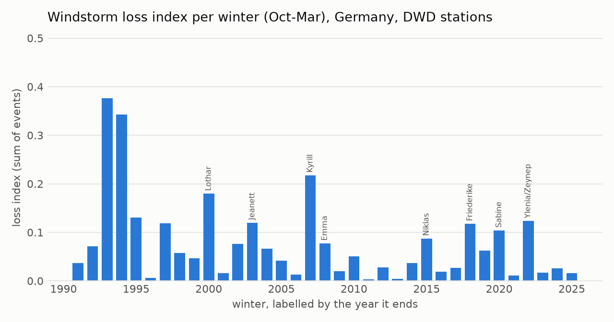
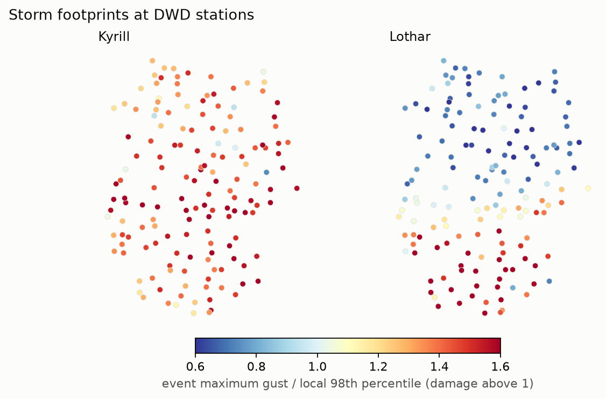
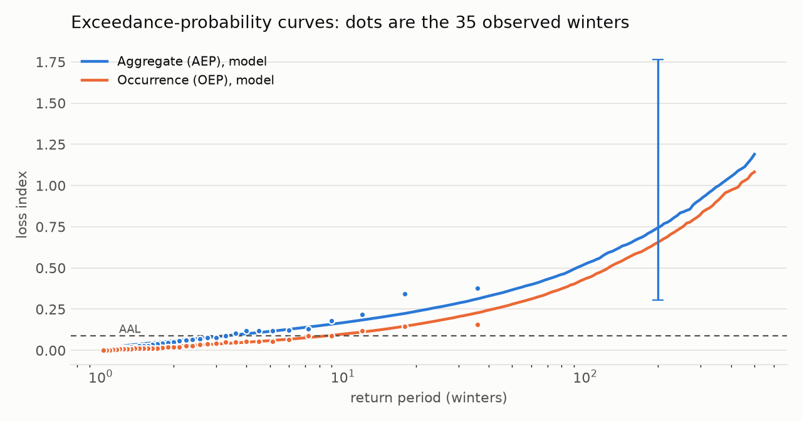

# German windstorm risk from open data: hazard to loss (v0.1)

How large is a 1-in-200-year windstorm loss in Germany, and how well can 35 winters of observations pin it down? This project builds the hazard-to-loss chain of a catastrophe model from open data only: daily maximum gusts at 156 DWD stations (winters 1990/91 to 2024/25), a storm loss index weighted by population, an event set with a 72-hour clause, extreme value statistics and the insurance metrics a cat model reports (average annual loss, exceedance-probability curves, 1-in-200 loss, tail value at risk).

**Main findings**
- The index finds the known storms without being told about them: Kyrill (January 2007) is the largest event of the 35 winters, Lothar (December 1999) third, and Jeanett, Ylenia/Zeynep, Emma, Sabine and Friederike are all in the top twelve. Lothar affects only 68 of 156 stations, in the south and south-west, as it did.
- Storm losses are heavy-tailed: the generalised Pareto shape parameter of event losses is about 0.6 (0.42 to 0.75 depending on the threshold). A Kyrill-size event recurs about every 20 winters in the model.
- The 1-in-200 annual loss is 8.3 times the average annual loss, but its uncertainty is the real result: resampling the 35 winters gives a 90% range of 0.31 to 1.77 index units around 0.74, a factor of almost six, and the choice of threshold alone moves it between 0.50 and 1.30. Thirty-five years of history cannot fix a 200-year loss; this is why the industry relies on stochastic event sets and why reanalysis and climate-model data matter.
- The seasonal loss index falls over the period (Kendall's tau -0.23, p = 0.048; events above the threshold tau -0.36, p = 0.005), driven by the very stormy early 1990s. With changes in instruments and station siting over 35 years, this is not read as a climate trend.

## Results



Largest events (loss index; stations with gusts above their local 98th percentile, of 156):

| Rank | Dates | Storm | Loss index | Stations above v98 | Highest gust (m/s) |
|---|---|---|---|---|---|
| 1 | 17-19 Jan 2007 | Kyrill | 0.155 | 149 | 55.4 |
| 2 | 26-28 Jan 1994 | | 0.147 | 154 | 49.5 |
| 3 | 26-28 Dec 1999 | Lothar | 0.120 | 68 | 54.8 |
| 4 | 7-9 Dec 1993 | | 0.094 | 134 | 50.4 |
| 5 | 13-15 Jan 1993 | | 0.090 | 113 | 52.9 |
| 6 | 25-27 Oct 2002 | Jeanett | 0.087 | 148 | 50.8 |
| 7 | 22-24 Jan 1993 | | 0.080 | 146 | 47.8 |
| 8 | 16-18 Feb 2022 | Ylenia/Zeynep | 0.067 | 149 | 42.3 |
| 9 | 25-27 Nov 1992 | | 0.060 | 137 | 47.8 |
| 10 | 29 Feb-2 Mar 2008 | Emma | 0.056 | 154 | 53.1 |
| 11 | 9-11 Feb 2020 | Sabine | 0.055 | 149 | 49.1 |
| 12 | 18-20 Jan 2018 | Friederike | 0.054 | 108 | 56.5 |

Storm names are attached only to events whose dates match the well-documented storms listed in `run.py`; other events are left unnamed.





| Return period (winters) | Aggregate loss (AEP) | x AAL | Largest event (OEP) | OEP from a GEV on seasonal maxima |
|---|---|---|---|---|
| 10 | 0.168 | 1.9 | 0.098 | 0.095 |
| 50 | 0.366 | 4.1 | 0.280 | 0.304 |
| 100 | 0.523 | 5.8 | 0.432 | 0.491 |
| 200 | 0.744 | 8.3 | 0.656 | 0.787 |
| 250 | 0.836 | 9.3 | 0.742 | 0.915 |

Average annual loss 0.090 in the model and 0.078 in the 35 observed winters (the heavy fitted tail adds expected loss beyond the observed record). Tail value at risk at 99.5% of the annual aggregate: 1.95. All numbers are in loss-index units; they compare events and return periods with each other and are not euros.

Parameter uncertainty (200 bootstrap resamples of whole winters, `results/bootstrap.csv`) and threshold sensitivity (`results/gpd_threshold_stability.csv`):

| | 5% | median | 95% |
|---|---|---|---|
| GPD shape xi | 0.31 | 0.56 | 0.83 |
| AAL | 0.060 | 0.089 | 0.151 |
| 1-in-200 aggregate | 0.31 | 0.65 | 1.77 |
| 1-in-200 largest event | 0.22 | 0.56 | 1.68 |

| Threshold (event-loss quantile) | Events above | xi | AAL | 1-in-200 aggregate |
|---|---|---|---|---|
| 80% | 172 | 0.75 | 0.112 | 1.30 |
| 85% | 129 | 0.55 | 0.086 | 0.63 |
| 90% (base) | 86 | 0.60 | 0.089 | 0.74 |
| 95% | 43 | 0.42 | 0.082 | 0.50 |

## Method

- **Hazard.** DWD daily station observations: the daily maximum gust FX. Stations with records from 1990 to 2025 and gusts on at least 90% of winter days (October to March): 156 stations in all 16 states.
- **Vulnerability: storm loss index** after Klawa and Ulbrich (2003). Damage at a station starts when the gust exceeds the local 98th percentile v98 of daily maximum gusts and grows with the cube of the excess, `max(0, v / v98 - 1)^3`, which accounts for buildings being adapted to their usual wind climate.
- **Exposure.** Each state's population on 1 January 2024 (Eurostat, NUTS-1) is split equally between its stations; weights sum to one. Days with missing stations are renormalised to the reporting ones.
- **Event set.** Storm days are merged into events of at most three days (a 72-hour clause, as in reinsurance treaties); an event's footprint is each station's highest gust over its days: 861 events in 35 winters.
- **Extreme values.** Peaks over threshold: events above the 90th percentile of event losses (2.5 per winter) arrive as a Poisson process and their excess follows a generalised Pareto distribution (maximum likelihood); smaller events are resampled from the observed ones. A GEV fit to the largest event of each winter cross-checks the occurrence curve.
- **Loss metrics.** 100,000 simulated winters give the aggregate (AEP) and occurrence (OEP) exceedance-probability curves, average annual loss, the 1-in-200 loss (99.5% value at risk, the Solvency II calibration level) and tail value at risk. Parameter uncertainty: bootstrap over whole winters with refit and resimulation.

## Data

| Source | Content | Licence |
|---|---|---|
| [DWD Climate Data Center](https://opendata.dwd.de/climate_environment/CDC/observations_germany/climate/daily/kl/) | Daily station observations (KL): maximum gust FX, precipitation RSK | CC BY 4.0, source: Deutscher Wetterdienst |
| [Eurostat demo_r_d2jan](https://ec.europa.eu/eurostat/databrowser/view/demo_r_d2jan/default/table) | Population on 1 January by NUTS-1 region | CC BY 4.0, source: Eurostat |

Raw files (about 180 MB) are downloaded into `data/raw/` on the first run and not committed.

## Run

```bash
python -m venv .venv
.venv/Scripts/activate            # Windows; on Linux/macOS: source .venv/bin/activate
pip install -e ".[test]"
python -m windrisk.run            # downloads and caches the data, writes results/ and figures/
pytest                            # offline tests
```

## Limitations

- Loss index, not euros: no calibration to insured losses, and population stands in for insured values.
- Stations, not a grid: 156 points sample the wind field; coastal and mountain stations sit in different wind climates (handled by the local v98, but not by exposure).
- Thirty-five winters with possible inhomogeneities in gust measurements over time; the declining trend and the early-1990s cluster need homogenised or reanalysis data before any climate interpretation.
- Events are merged by date only (no storm tracking), and winter storms only: summer convective gusts are outside the event definition.

## Roadmap

- **v0.2**: ERA5 reanalysis gusts on a grid instead of stations (Copernicus Climate Data Store), the same chain, and a comparison with the station result.
- **v0.3**: compound wind and rainfall extremes (the RSK precipitation already downloaded), dependence between hazards (tail dependence, copulas) and its effect on the joint loss.
- **v0.4**: exposure on a population or building grid, calibration of the index to published insured storm losses, and a stochastic event set to narrow the 1-in-200 uncertainty.

## Reference

Klawa, M. and Ulbrich, U. (2003): A model for the estimation of storm losses and the identification of severe winter storms in Germany. *Natural Hazards and Earth System Sciences*, 3, 725-732. https://doi.org/10.5194/nhess-3-725-2003
